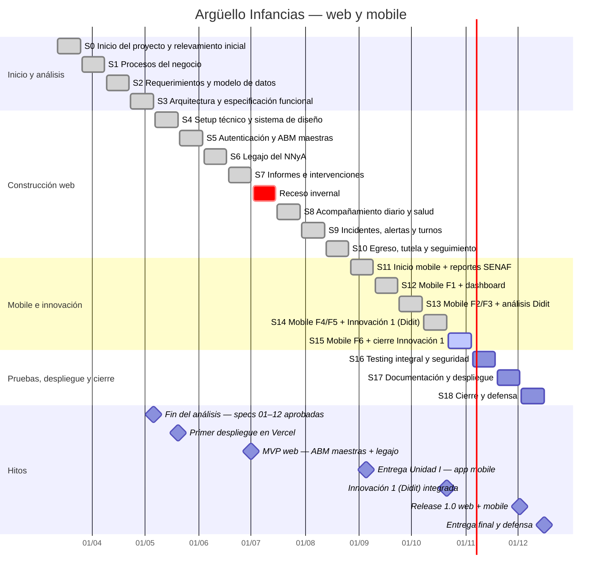
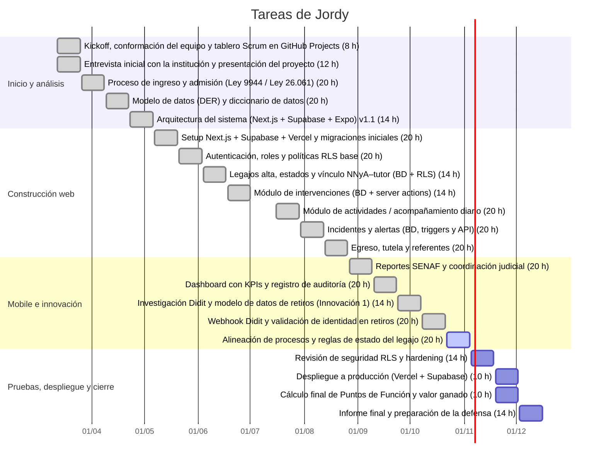
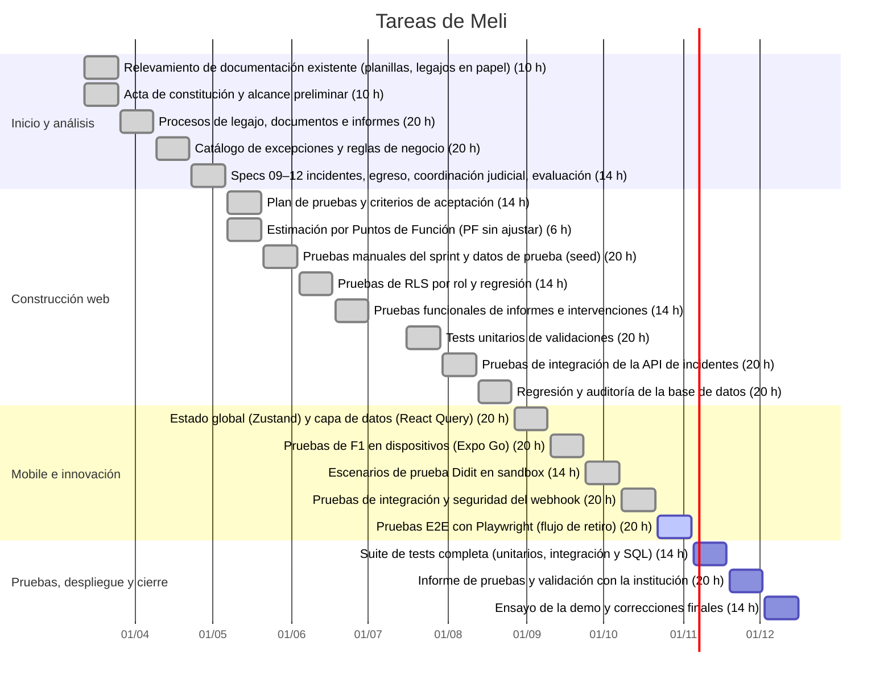
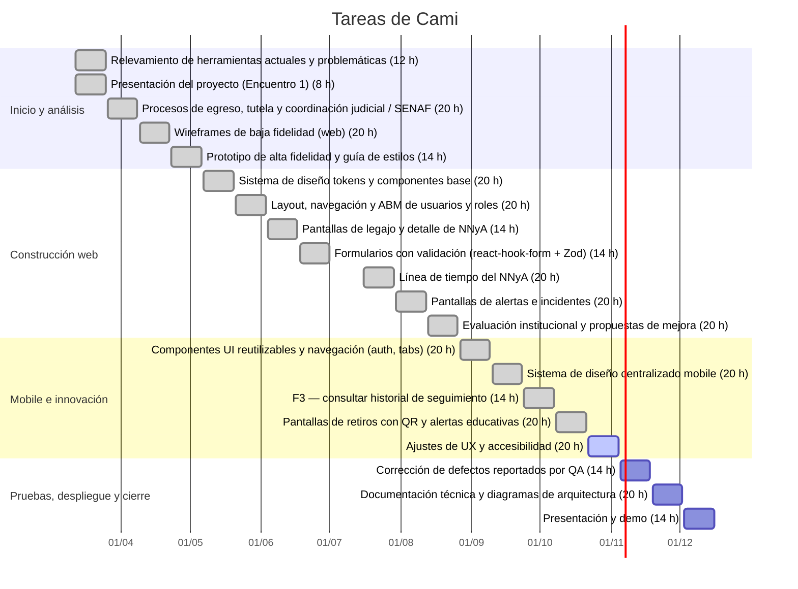
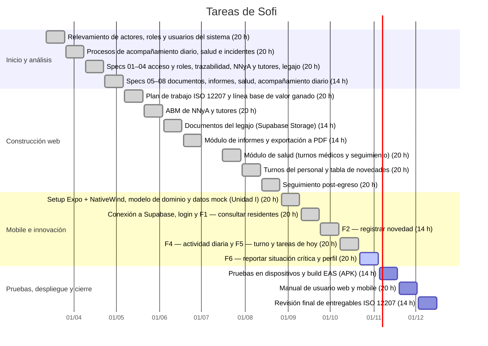

# Diagrama de Gantt — Argüello Infancias — Sistema de gestión de residencia NNyA (web + mobile)

GitHub dibuja este diagrama automáticamente. Las tareas detalladas están en `SPRINTS.md`.

## Jordy

## Meli

## Cami

## Sofi

